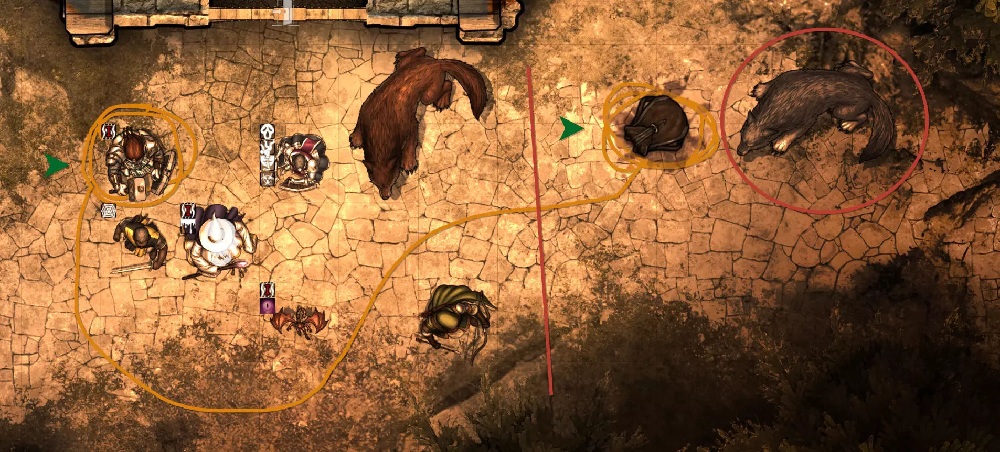

# Sketching on the Canvas

**Audience:** any player or GM who wants to draw on the map while the party is planning.

The sketching tool end to end: the shapes, the controls, what everyone else sees, and how drawings
clear themselves away.

Sketches are temporary by design. They are for working something out together -- who goes through
the door first, where the archers stand -- not for keeping. Nothing you sketch becomes part of the
scene. The things that do last are described under
[Stamps for quick maps](#stamps-for-quick-maps), [Paths and ground](#paths-and-ground) and
[Draw walls](#draw-walls).

## Start drawing

Click **Cartographer** in the scene controls down the left of the canvas, then drag on the map.

**Who can do it:** any player, unless the GM has turned **Enable Player Drawing** off. The GM can
always draw.

## The drawing tools window

Click **Tools** in the **Drawing Tools** section of the Cartographer bar, or choose **Drawing Tools**
from the Cartographer button's right-click menu. A window opens with three tabs, **Drawing**,
**Stamps** and **Terrain**, holding the same controls as the bar and more. The buttons in the bar stay where they are, and the
two follow each other: choose a tool in one and the other shows it.

Picking a tool or a stamp in the window starts drawing at once, and in the window a stroke is plain
**press, drag, release** with the left button -- nothing is drawn until you press. Right-drag still
pans the map, and Ctrl or Alt leave the click to Foundry. A click with no drag draws nothing. **Stop
drawing** in the window's footer, or closing the window, puts the map back to normal. The draw hotkey
below is separate and works as it always did. **Undo** in the footer takes back the last thing you drew, wall or stamp kept on the scene
included.

## Choose what to draw

The Cartographer tool offers five shapes:

- **Sketch** -- freehand, following the pointer.
- **Line** -- a straight line from where you press to where you release.
- **Box** -- a rectangle.
- **Ellipse** -- a circle or oval.
- **Stamp** -- drops a marker where you click, rather than drawing a shape.

Pick one, then drag on the canvas. The choice is remembered for you between sessions.

## Change how it looks

The toolbar groups its controls under headings -- **Drawing Mode**, **Stamp Style**, **Stamp Size**,
**Line Weight**, **Line Style**, **Color** and **Utilities**:

- **Colour** -- your colour. It defaults to the colour Foundry assigns your user, so several people
  can draw at once and the table can tell who drew what.
- **Line weight** and **line style** -- how heavy the stroke is and whether it is solid or broken.
- **Stamp style** and **stamp size** -- which marker the stamp drops, and how large.

Each is remembered per person, so your settings are yours and do not change anybody else's.

## Draw without leaving the tool you are using

Cartographer registers a hotkey so you can sketch mid-planning without switching tools. It is
**L** unless you change it, and Foundry's own Controls settings is where you change it.

By default it works while **held**: press and hold, draw, let go, and you are back where you were. It
can be set to **toggle** instead, so one press turns drawing on and another turns it off. See
**Draw Hotkey Mode** in [Settings](userguide-settings.md).

The hotkey ignores you while you are typing in chat, so an `L` in a message does not start a drawing.
That can be turned off with **Ignore Hotkey While Typing**.

## Stamps for quick maps

The **Stamps** tab is for putting a map together fast. Its stamps are drawn in code, so they take
the colour you choose and are never the same twice:

- **Trees** -- a tree and a pine.
- **Plants** -- a shrub, a tuft of grass and flowers.
- **Rocks** -- a rock and a pile of boulders.
- **Features** -- a stump, a log, a pond and a campfire.
- **Markers** -- the plus, X, dot, arrows and square the tool has always had.

Click a stamp, then click the map to put one down, or **drag to scatter** several along the stroke.
**Scatter spacing** sets how far apart they fall.

The options under the stamps:

- **Size** -- small, medium or large. A medium tree is bigger than a medium tuft of grass, so a
  scattering of mixed stamps looks right.
- **Natural colors** -- draws each stamp in its own colours. Off tints it with your brush colour
  from the Drawing tab. Markers are always your brush colour.
- **Turn and flip** and **Vary the size** -- give each stamp a random turn, flip and size so a
  row of trees does not look stamped. The faint preview that follows the pointer shows the stamp
  exactly as it will land.
- **Keep on the scene** -- off, a stamp is temporary like a sketch. On, it is written to the scene as
  Foundry Drawings, so it is still there after a reload or a change of scene, and the GM can move
  or delete it with Foundry's own Drawing tools. It needs permission to create Drawings, which the GM
  always has; a player the world does not allow to create them gets a temporary stamp.

## Paths and ground

The **Terrain** tab lays makeshift paths and ground. Click a kind, then **drag along the map**; the
path follows your stroke, smoothed, with the ground's texture scattered over it:

- **Dirt**, **Gravel**, **Sand** and **Mud** -- tracks and trails.
- **Cobbles** -- a laid road.
- **Boardwalk** -- planks across the path.
- **Stream** -- water with ripples, for a ford or a brook.

**Width** is in grid squares -- narrow is half a square, wide is two. **Keep on the scene** works as it
does for stamps: off, the path is temporary and everyone sees it; on, it is written to the scene as Foundry
Drawings. A kept path holds fewer specks of texture than a temporary one, to keep the scene light.
Undo takes back a whole path.

## Draw walls

**Wall** is the last tool on the Drawing tab, for the GM only. A wall stroke makes both the line you
can see and the wall underneath it, so a quick map is playable at once:

- **Straight** -- one wall, from where you press to where you let go.
- **Freehand** -- the stroke is straightened into a run of walls, and closed into a ring if it ends
  near where it began.

**Snap to the grid** puts wall ends on the points Foundry's own wall tool snaps to; turn it off to
place them exactly. Walls follow the same **Join Walls Where They Meet** setting as the walls
tool, so a wall let go near another's end joins it. The line is drawn in your brush colour and
weight as a Foundry Drawing, and is kept: unlike a sketch, a wall does not clear itself. **Undo**
takes back the walls and their line together.

## What everyone else sees

Drawings appear on other people's screens as you make them, not when you finish. Everyone connected
to the scene sees them, players and GM alike, each in the drawer's own colour.

There is no private sketch. If you draw it, the table sees it.

## How drawings clear

Three things remove a drawing, and you do not have to tidy up after yourself:

- **Changing scene** clears yours.
- **Disconnecting** clears yours.
- **Timed erase**, if it is switched on, removes each drawing a set number of seconds after it is
  drawn. The GM sets the delay with **Timed Erase Timeout (seconds)**; the toggle for whether it
  applies to your drawings is on the toolbar.

A GM can also clear everything on the canvas at once.

## What it does not do

Sketches, lines, boxes, ellipses and temporary stamps are not Foundry Drawing objects. They are not
saved with the scene, they cannot be selected or edited after you release the mouse, and they do
not survive a reload. To keep one, use a kept stamp or a wall, or draw it with Foundry's own Drawing
tools.

Wall strokes and kept stamps are Foundry Drawings and walls, so Clear mine and Timed erase do not
touch them; remove them with Undo, or with Foundry's own tools.
